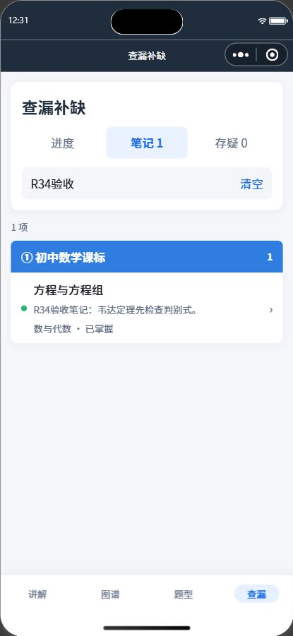
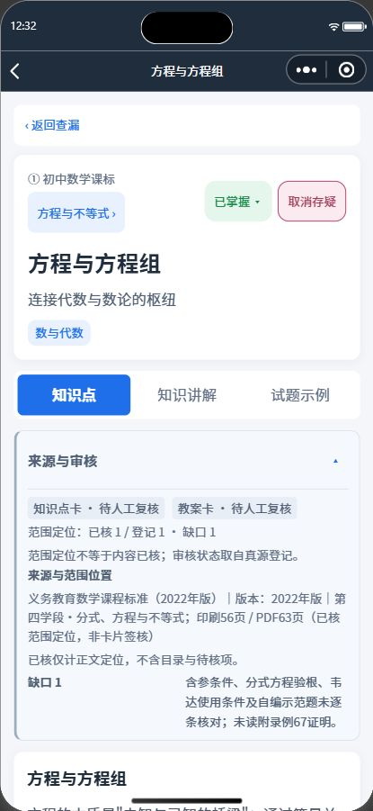

# 数海扶摇 · K12 数学竞赛知识图谱

按「专题讲解 → 建立框架 → 题型查找」组织竞赛数学学习，覆盖小学到奥赛四个学段。原生微信小程序，内容内置、离线可读；支持自主标记进度、笔记与存疑，另附 A3 挂图。

| 专题首页 | 查漏 · 笔记查询 | 按需展开来源 |
|---|---|---|
|  |  |  |

以上为 **R34 禁云、独立 storage 的手机隔离模拟器证据，非真机截图**，记录为合成测试数据。R33/R34 代表性隔离验收 PASS，不代表全设备、真实云同步或投屏验收；范围与证据见 [测试台账](docs/TESTS.md) 的 VFY-008 / VFY-009。

## 它解决什么问题

竞赛学习常见的困境是知识散、进度快、没有框架：做了很多题，却说不清某个专题的本质、方法和易错边界。本项目把内容拆成 **67 个知识点**（小学 10 / 初中 21 / 高中 15 / 奥赛 21），每个点配四类卡片（知识点、讲解教案、易错考点、真题示范），再用知识图谱、题型定位和查漏清单把点连成网，便于逐点讲解与按图自查。

## 主要功能

- **讲解与图谱**：按「本质 / 核心方法 / 讲解例题 / 易错点 / 知识连接 / 概念自检」六段式阅读；图谱按来源或 11 个主题查看，另有 12 条跨学段衔接桥。例题提示与解答独立折叠。
- **题型定位与自主状态**：按题目特征定位知识点；显式选择「未开始 / 学习中 / 已掌握」，由使用者自主判断，不做程序内考试、评分或掌握认证。
- **会话阅读与草稿保护（B2）**：返回时恢复筛选、页签、展开和滚动位置；应用可控制的离开操作会询问继续编辑或放弃未保存笔记，保存失败保留草稿。仅当前会话有效，不自动保存，不承诺进程结束后恢复。
- **查漏三视图（B4）**：在「进度 / 笔记 / 存疑」间切换；笔记支持正文查询、摘要与直达笔记位置，清空笔记或取消存疑后按当前记录更新。个人存疑不改变内容审核状态，也不自动提交纠错。
- **按需来源（B6）**：状态与操作用短文案直接表达；来源、审核状态、范围定位及缺口按需展开，内容待核信息仍可查。
- **离线优先、可选同步**：记录先保存在本地；已实现微信云开发字段级同步，每微信账号一份共用记录，不设孩子档案。真实云权限、跨账号隔离和手机/iPad 真机互通仍待 VFY-007 验收，启用前须核对下方升级说明。

本轮不做 B1 全文搜索增强、B3 本机继续阅读、B5 同步中心。已有手机/iPad 固定方向的部分模拟器证据，不承诺全机型和全方向通过；投屏页保留，但后续实时旋转、onResize 与电视镜像验收为 **SKIPPED（用户暂缓），不是 PASS**，已知 onResize 问题未因此解决。

历史投屏截图仅作路径入口保留：[封面](tests/evidence/simulator/README_present_cover.jpg) · [知识点页](tests/evidence/simulator/README_present_essence.jpg) · [解析页](tests/evidence/simulator/README_present_answer.jpg)；不作为当前真机或投屏验收证据。

## 快速开始

前置：Node.js 18+、[微信开发者工具](https://developers.weixin.qq.com/miniprogram/dev/devtools/download.html)。

```bash
git clone https://github.com/gzchenjiesong/k12-math-knowledge-map.git
```

1. **先准备离线配置，再编译/运行**：将 `apps/miniprogram/utils/cloud-config.js` 中的 `env` 改为 `''`。仓库当前带有非空云环境 ID，**并非默认禁云**，首次 clone 不应直接连接该环境。
2. 打开微信开发者工具，选择「导入项目」，目录指向仓库的 `apps/miniprogram/`。将项目 AppID 替换为**你自己的**小程序 AppID（测试号仅用于支持范围内的离线体验），不要沿用作者 AppID。
3. 内容无需安装依赖或预先构建：`apps/miniprogram/data/` 的 **7 个 JS 模块及 `manifest.generated.json` 已入库**。完成上述配置后可直接离线运行，无需 `npm install`。
4. 在仓库根目录运行 `npm test` 做工程回归；Node.js 18+、零第三方依赖，11 组检查按下方顺序执行，失败即停止。
5. 云端同步可选；如需启用，配置**自己的**云环境并先核实下方权限、版本升级和验收边界。清空 env 是首次使用者主动执行的离线步骤，不代表本轮改动了仓库云配置。

仓库还包含由数据生成的静态交付物：`deliverables/olympiad-poster-A3.html`（按学段）和 `deliverables/olympiad-poster-themes-A3.html`（按主题），浏览器打开即可打印成 A3 挂图。

## 关于内容可信度

所有讲解与例题均为**基于数学公共知识的原创编写**，不复制付费教材原文，也不内嵌盗版资料。内容已做结构、数值、定理条件等机械校验，但**尚未经人工对照学校讲义逐条核对**，不保证零错误，请以孩子集训队讲义与授课老师口径为准。发现错误欢迎提 issue 反馈（见文末）。

### 资料追溯现状

来源台账见 `reliable-data/evidence/SOURCES.json`，节点映射见 `reliable-data/evidence/NODE_SOURCES.json`。目前登记11条来源，取得3条来源的4个PDF（含1份备用本，不入Git），并为67个节点建立117条引用。

42个节点已定位到两份数学课标的范围章节；这**不等于定义、定理或题解逐条核准**。全部67个节点仍保留相关缺口，268张卡仍为 `pending`。没有把入口可访问、模型阅读或哈希通过算成人工签核，也没有宣称已取得的2022/2020课标是最新版。完整事实与版权说明见 `reliable-data/evidence/README.md`。

可靠性流程继续由仓库承担：可靠来源 → 多模型独立复核 → 实际教学中的人工对照与纠错 → 更新卡片。应用只忠实呈现这些结果；资料补充不会自动升级卡片审核状态。

### 同步升级说明

新版按字段记录实际变更、保留删除版本，以稳定操作ID幂等重试，避免旧快照覆盖新修改。原本地记录和旧云文档只读迁移、不删除；云端不可用时待发送操作保留在本地。

**启用前需核实**现有集合采用基础权限「仅创建者可读写」；当前实现不支持直接换成自定义安全规则。同一账号的所有设备须先升级，不能新旧版本混用或直接回滚旧版（旧版可能误读/覆盖新版操作文档及本地元数据）。隔离回归的当前数量与结果以 `docs/TESTS.md` 的 TST-021 / TST-024 / TST-025 及执行摘要为准；真实云权限、手机/iPad 双机真机同步、宿主跨账号 storage 隔离、包体与性能仍属 VFY-007 **BLOCKED_NO_EVIDENCE**。

操作日志会随修改持续增长，拉取成本随历史量增加，当前没有自动压缩/删除历史，不能用“只有几 KB”描述日志或保证性能。协议及运行限制见 `docs/CONFIG.md` 的 CNF-022。`deploy/server/` 仅为历史自建快照 API 样例，**不兼容当前微信云操作协议，不能只配 `runtime-config.js` 启用**；详见其 [R35 说明](deploy/server/README.md)。

## 数据生产流程

内容真源在 `reliable-data/`，应用数据是从真源编译出的生成物，不是手工维护的副本：

```
resource_data/           reliable-data/            apps/miniprogram/
  原始资料（不入库）  →   唯一真源（JSON）      →     生成物 data/*.js
  课标 / 大纲 / 笔记      67 节点 × 四类卡片         小程序直接读取
```

7 个 JS 模块和 `manifest.generated.json` 随仓库入库，完成首次离线配置即可运行；修改内容时改真源并重新生成，不要直接编辑这些生成物。当前 268 卡全部 `pending`，构建必须显式加 `--allow-pending`，这是带待核状态的过渡构建，**不升级审核状态**；旧反向编制器 `tools/build-reliable-data.js` 已退役，不得用来回写真源。

```bash
node tools/build-data.js --allow-pending  # 真源 → 7 个 JS 模块及生成清单
node tools/build-poster.js               # 生成两版 A3 挂图
node tools/render-html.js                # 生成人读 HTML 视图（views/，不入库）
```

### 工程检查（R35）

Node.js 18+，零第三方依赖，**无需 `npm install`**。在仓库根目录执行：

```bash
npm test
```

根 `package.json` 按以下顺序执行 11 组检查，失败即停止；也可逐项运行（输出 `RESULT=通过/总数` 与 `VERDICT`）：

```bash
node tests/check-data.js                # 真源发布资格与结构
node tests/check-reliable-extra.js      # 哈希 / 覆盖 / 定理条件 / 异源复算
node tests/validate.js                  # 文档结构与小程序工程静态校验
node tests/verify_content.js            # 内容可判定子集的机械断言
node tests/check-app-build.js           # 生成物与真源一致性
node tests/check-sources.js --self-test  # 来源追溯与变异自测
node tests/check-data-contract.js       # 真源/镜像/审核/答案变异与字节级重建
node tests/check-sync.js                # 隔离同步回归，不连接真实云
node tests/check-ui.js                  # 页面交互与展示回归
node tests/check-reading-context.js     # 会话阅读上下文与草稿保护
node tests/check-records.js             # 笔记/存疑聚合及记录交互
```

来源原件在不入库的 `resource_data/`；首次 clone 不包含这些原件，不能把结构或自测通过当成原件哈希已核验。具体检查范围、缺证与最近数量以 `docs/TESTS.md` 为准，工程入口约定见 CNF-025 / TST-025。

机械校验通过只说明各脚本覆盖的结构和可判定部分无误，**不等于内容已被人工核准**，也不替代真实云、真机或投屏验收。本轮工程整理不改变真源、审核状态或微信审核/发布状态。

## 目录结构

| 目录 | 说明 |
|---|---|
| `apps/miniprogram/` | 微信小程序工程；`data/` 的 7 个 JS 及 `manifest.generated.json` 为入库生成物 |
| `reliable-data/` | 内容唯一真源：四类卡片、依据锚点、版本快照与变更记录 |
| `tools/` | 数据、HTML 视图、A3 挂图的生成脚本 |
| `tests/` | 校验脚本与证据记录（含模拟器截图） |
| `deliverables/` | A3 挂图、品牌素材等静态交付物 |
| `docs/` | 项目治理文档：契约、规则、配置、设计与变更索引（维护者参考） |
| `resource_data/` | 本地原始资料，不入库 |
| `deploy/` | 历史自建进度服务与配置样例，非当前微信云协议部署入口 |

## 参与和反馈

- **发现内容错误**：请提 GitHub issue，注明知识点 ID、问题所在卡片和建议改法；错误讲解比缺失危害更大，优先处理。
- **改进功能 / 修 bug**：欢迎 PR；改内容请改真源并重新生成，改工程请先阅读 `docs/` 下的契约与规则。
- **维护者文档**：治理口径与变更索引见 `docs/INDEX.md`。

## 许可

MIT License，详见 [LICENSE](LICENSE)。内容原创编写，不含教材原文或第三方版权素材。
