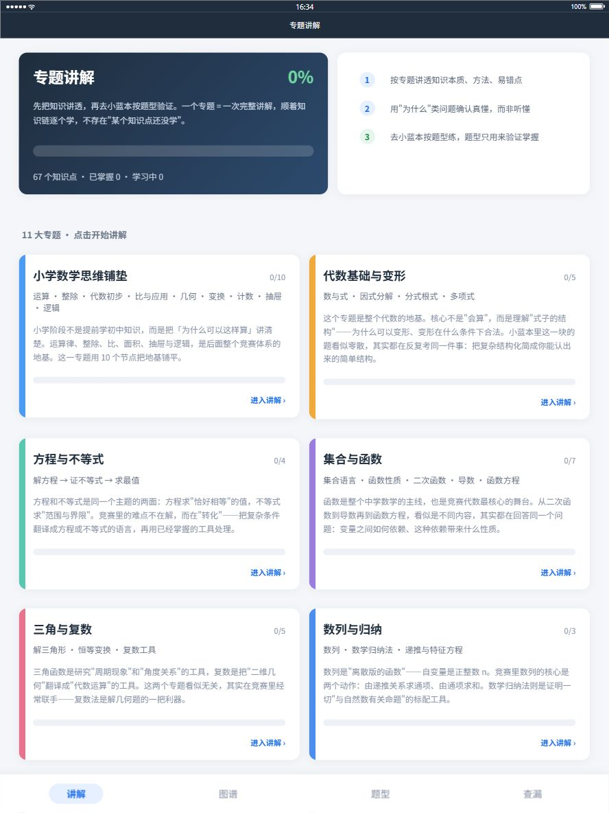
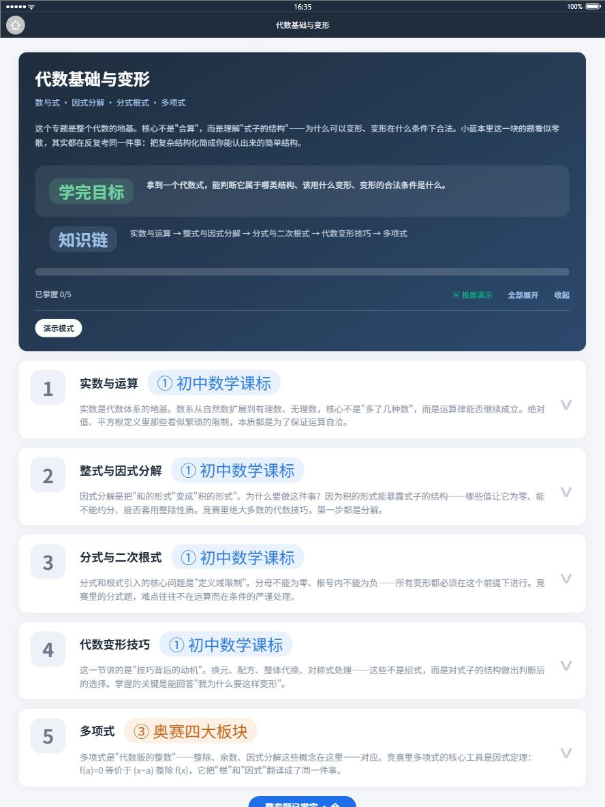
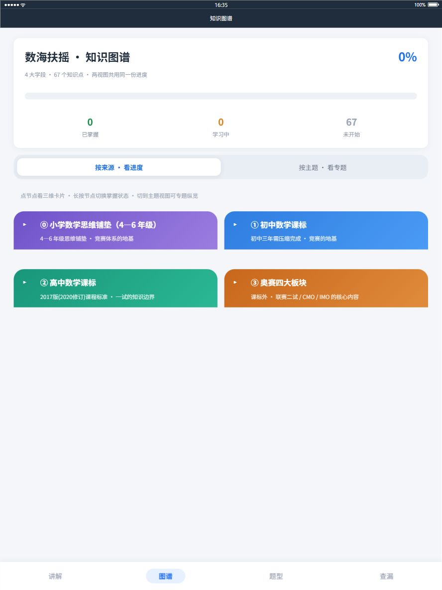
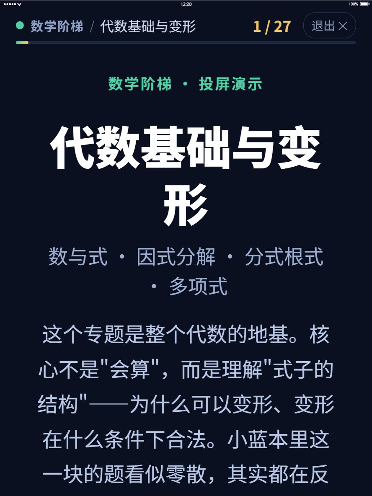

# 数海扶摇 · K12 数学竞赛知识图谱

面向家庭的竞赛数学学习工具：按「专题讲透 → 建立框架 → 按题型验证」的路径，帮孩子从散点刷题转向有体系的学习。覆盖小学到奥赛四个学段，以微信小程序交付，内容内置、离线可用；另附 A3 挂图等可打印材料。

| 讲解首页 | 讲解详情 |
|---|---|
|  |  |

| 知识图谱 | 投屏演示 |
|---|---|
|  |  |

## 它解决什么问题

竞赛学习常见的困境是知识散、进度快、没有框架：孩子做了很多题，却说不清某个专题的本质、方法和易错边界。本项目把内容拆成 **67 个知识点**（小学 10 / 初中 21 / 高中 15 / 奥赛 21），每个点配四类卡片（知识点、讲解教案、易错考点、真题示范），再用知识图谱、题型定位和查漏清单把点连成网，家长可以逐点讲、孩子可以按图自查。

## 主要功能

- **讲解卡片**：每个知识点按「本质 / 核心方法 / 讲解例题 / 易错点 / 知识连接 / 概念自检」六段式组织，便于逐点讲透。
- **双视图知识图谱**：按知识来源看纵向脉络，按 11 个主题看横向联系；另有 12 条跨学段衔接桥，标出小学到初中、初中到高中/奥赛的过渡关系。
- **题型定位**：从题目特征反查对应知识点，用来验证掌握程度。
- **查漏清单**：按掌握状态汇总待复习节点，支持跨学段分组。
- **投屏演示**：全屏大字幻灯片，适合在电视或平板上全家共学。
- **离线优先**：内容全部内置，无网络也能用；学习进度先存本地，可选开启微信云开发做跨设备同步。
- **多屏适配**：手机、平板、横屏均可使用。

## 快速开始

前置：Node.js 18+、[微信开发者工具](https://developers.weixin.qq.com/miniprogram/dev/devtools/download.html)。

```bash
git clone https://github.com/gzchenjiesong/k12-math-knowledge-map.git
```

1. 打开微信开发者工具，选择「导入项目」，目录指向仓库的 `apps/miniprogram/`。
2. AppID 请填**你自己的**小程序 AppID，或选择「测试号」体验。仓库内置的是作者 AppID，非本人使用时须替换。
3. 无需构建：`apps/miniprogram/data/*.js` 已随仓库提供，导入后即可运行。
4. 云端同步是可选功能；未配置云环境时，应用以纯离线方式正常工作。

仓库还包含由数据生成的静态交付物：`deliverables/olympiad-poster-A3.html`（按学段）和 `deliverables/olympiad-poster-themes-A3.html`（按主题），浏览器打开即可打印成 A3 挂图。

## 关于内容可信度

所有讲解与例题均为**基于数学公共知识的原创编写**，不复制付费教材原文，也不内嵌盗版资料。内容已做结构、数值、定理条件等机械校验，但**尚未经人工对照学校讲义逐条核对**，不保证零错误，请以孩子集训队讲义与授课老师口径为准。发现错误欢迎提 issue 反馈（见文末）。

## 数据生产流程

内容真源在 `reliable-data/`，应用数据是从真源编译出的生成物，不是手工维护的副本：

```
resource_data/           reliable-data/            apps/miniprogram/
  原始资料（不入库）  →   唯一真源（JSON）      →     生成物 data/*.js
  课标 / 大纲 / 笔记      67 节点 × 四类卡片         小程序直接读取
```

生成物随仓库入库以保证 clone 即可运行；修改内容时改真源并重新生成，不要直接编辑 `apps/miniprogram/data/*.js`。

```bash
node tools/build-data.js --allow-pending  # 真源 → 7 个 app 数据模块
node tools/build-poster.js                # 生成两版 A3 挂图
node tools/render-html.js                 # 生成人读 HTML 视图（views/，不入库）
```

校验脚本（统一输出 `RESULT=通过/总数` 与 `VERDICT`）：

```bash
node tests/check-data.js            # 真源发布闸门
node tests/check-reliable-extra.js  # 哈希 / 覆盖 / 定理条件 / 异源复算
node tests/validate.js              # 文档结构与小程序工程静态校验
node tests/verify_content.js        # 内容可判定子集的机械断言
node tests/check-app-build.js       # 生成物与真源一致性
```

机械校验通过只说明结构和可判定部分无误，**不等于内容已被人工核准**。

## 目录结构

| 目录 | 说明 |
|---|---|
| `apps/miniprogram/` | 微信小程序工程；`data/*.js` 为生成物 |
| `reliable-data/` | 内容唯一真源：四类卡片、依据锚点、版本快照与变更记录 |
| `tools/` | 数据、HTML 视图、A3 挂图的生成脚本 |
| `tests/` | 校验脚本与证据记录（含模拟器截图） |
| `deliverables/` | A3 挂图、品牌素材等静态交付物 |
| `docs/` | 项目治理文档：契约、规则、配置、设计与变更索引（维护者参考） |
| `resource_data/` | 本地原始资料，不入库 |
| `deploy/` | 可选的进度服务实现与配置样例 |

## 参与和反馈

- **发现内容错误**：请提 GitHub issue，注明知识点 ID、问题所在卡片和建议改法；错误讲解比缺失危害更大，优先处理。
- **改进功能 / 修 bug**：欢迎 PR；改内容请改真源并重新生成，改工程请先阅读 `docs/` 下的契约与规则。
- **维护者文档**：治理口径与变更索引见 `docs/INDEX.md`。

## 许可

MIT License，详见 [LICENSE](LICENSE)。内容原创编写，不含教材原文或第三方版权素材。
